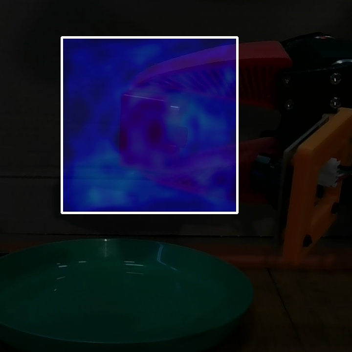
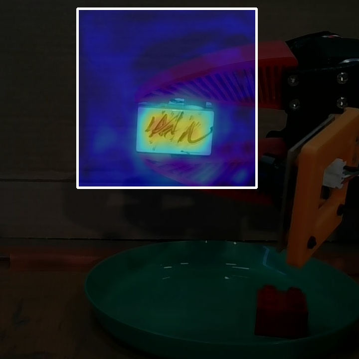
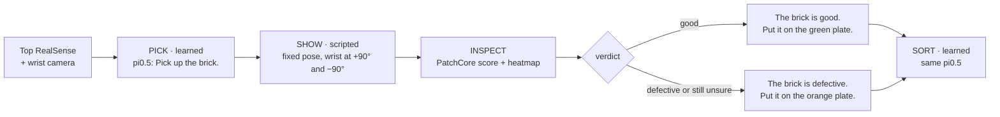

# Jenssenit: pick, inspect and sort Duplo bricks on one Intel laptop

An SO-101 robot arm picks Duplo bricks, shows each one to an inspection camera and sorts it onto a
green or an orange plate. A vision-language-action model (**pi0.5**, fine-tuned in
[Physical AI Studio](https://github.com/open-edge-platform/physical-ai-studio)) does the picking
and placing. **Anomalib PatchCore** checks every brick, and its verdict becomes the VLA's next task
sentence. All inference runs on one Intel Core Ultra laptop with **OpenVINO**.

Built in one weekend by team Jenssenit at [Junction 2026](https://www.hackjunction.com) for the
Intel Physical AI Challenge (Ignite Next × Intel).

<!-- TODO before publishing: video link, deck PDF link -->

<table>
  <tr>
    <td></td>
    <td></td>
  </tr>
  <tr>
    <td>Clean brick: score 0.05, <b>good</b> → green plate</td>
    <td>Marker defect: score 0.96, <b>defective</b> → orange plate</td>
  </tr>
</table>

*Real inspection photos from a run on the arm. Only the square around the brick is scored.*

## Results on the arm

Final settings, 2026-11-14, model `Pi0.5-v2-8gpu`. Every inspected brick was labelled by eye from
its photos.

| | Result |
|---|---|
| Bricks through the whole loop | 52 |
| Inspection verdict right | **48 of 52** |
| Defective bricks rejected | **16 of 16** |
| Clean bricks accepted | 32 of 36 |
| Picks that worked | 52 of 73 attempts (6 more stopped by the operator) |
| Median time per brick | 20.4 s: pick 7.5 s, inspect 3.9 s, sort 5.7 s |

Where each number comes from: [JUNCTION_SUBMISSION_FINAL.md](JUNCTION_SUBMISSION_FINAL.md).
The failures are counted below, under [Limits](#limits).

## How one cycle works



1. **Pick (learned).** pi0.5 gets the top and wrist cameras, the joint positions and the sentence
   `Pick up the brick.` The bricks can lie anywhere in reach.
2. **Show and inspect (scripted).** The arm holds the brick at one saved pose in front of a webcam
   and turns the wrist to +90° and −90°, the two faces no gripper finger covers. Each view's score is
   the median of 3 frames. A defective view rejects the brick at once. An unsure view gets a second
   look, and a brick that is still unsure is rejected.
3. **Sort (learned).** The verdict becomes the task sentence. The same pi0.5 model finds the plate
   of that colour, so the plates can be moved or swapped. No brick or plate positions are in the
   code.

**Why the show is scripted.** Anomaly detection flags anything that differs from its training
photos. When the arm held the brick in a slightly different pose each time, good bricks were
rejected ([ANOMALY_DATA_REVIEW.md](ANOMALY_DATA_REVIEW.md)). Our first live run still rejected a
clean brick at 1.0, with the heatmap hot on the wrist-camera bracket. Now each frame is cut to a
360 px square around the brick, found by colour at the tips of the red gripper fingers.

**Safety.** Every policy step is clamped: 2 joint units per tick at the start of a stage, ramping to
12 within a second. Scripted moves are eased and abort if a joint lags. A stage that times out
stops the arm, one key stops it at any time, and a device lock keeps two programs off it.

## On the laptop

Intel Core Ultra X9 388H, 64 GB RAM. Every model runs with OpenVINO.

| What | Device | Time | Note |
|---|---|---|---|
| pi0.5, one 50-step action chunk | GPU | about 240 ms | Median of 125 stages on the arm. Asynchronous execution keeps the arm moving meanwhile |
| PatchCore, one brick square | GPU | 35 ms (p95 61 ms) | In the loop, 267 photos. The GPU is free while the brick is shown |
| PatchCore, one brick square | CPU / NPU | 36 / 119 ms | Measured while the loop was running |
| PatchCore training | Intel GPU | 5 min | 641 good photos, 2% coreset |

- **INT8:** weight-only INT8 makes the PatchCore model 4× smaller (31 → 7.9 MB) with scores within
  0.05 of FP32. Full INT8 moved scores by up to 0.28, so we don't use it.
- **Heat:** the loop logs package temperature and CPU, GPU and NPU load. A 33-minute run averaged
  52 °C and peaked at 91 °C.
- **Earlier models:** SmolVLA and ACT, benchmarked on every device, are in
  [bench/RESULTS.md](bench/RESULTS.md).

## Data and training

- **Recorded by teleoperation** with the leader arm in Physical AI Studio. The raw dataset is never
  edited; we clean copies through Studio's API. All 242 sort labels were checked against the top
  camera ([DATASET_MAIN_CLEAN3.md](DATASET_MAIN_CLEAN3.md)).
- **pi0.5 fine-tuned on 424 episodes** (182 picks, 242 sorts, 45.5 min) on 8 H100s on Modal:
  4 epochs, 5,116 steps. Studio keeps the lowest-validation-loss epoch, which once shipped an
  undertrained model, so we train without a validation split and keep the final weights
  ([MODEL_RUN_NOTES.md](MODEL_RUN_NOTES.md)).
- **Multi-GPU training** needed changes to Studio's Modal backend:
  [GPU_SCALING.md](GPU_SCALING.md), with the edits in
  [patches/physical-ai-studio-multi-gpu.patch](patches/physical-ai-studio-multi-gpu.patch).
- **Bricks and plates were moved while recording.** The grasps cover about 34 × 40 cm, and each
  plate stood on both sides of the table.

## Limits

- **21 of 73 picks missed** and timed out. The top camera moved about 20 px after the recordings,
  and pi0.5 was trained without image augmentation.
- **4 clean bricks were rejected:** a green curved brick (3 times) and a tall yellow brick, shapes
  the good photos barely contain. Dark marker on blue bricks scored lowest of the defects (0.55 to
  0.77).
- **Only the two ungripped faces are checked.** The gripper reads the same holding a brick or not,
  so an empty grasp is only caught at inspection.
- **The loop logs each verdict, not where the brick landed.**

## What's in the repo

| Path | What |
|---|---|
| [`loop/`](loop/README.md) | The closed loop (`run_cell.py`): pick → show → inspect → sort, scripted moves, safety, logs and the operator screen at http://localhost:8080 |
| [`anomaly/`](anomaly/README.md) | Inspection: capture, the brick square, PatchCore training and OpenVINO export, INT8, score bands. The photos and the exported models are committed |
| [`physical-ai-studio/`](https://github.com/open-edge-platform/physical-ai-studio/tree/junction2026) | Submodule: Intel's Physical AI Studio (branch `junction2026`) for recording, training and export |
| [`patches/`](patches/) | Our edits to Studio for multi-GPU training on Modal |
| [`bench/`](bench/) | Latency, temperature and load benchmarks; `RESULTS.md` is generated by `make_table.py` |
| [`tools/`](tools/) | Read-only servo check, random brick and plate layouts, evaluation-round logging |
| [`video/`](video/README.md) | The submission video and slide deck, rendered from code with Remotion from our measured data |
| `policy/`, `recording/` | Early recording plans, out of date |

Not in the repo: the teleoperation datasets and the pi0.5 weights (a 6.3 GB OpenVINO export). They
live in Physical AI Studio's storage on the station laptop.

## Running it

### Try the inspection without hardware

This runs the exported PatchCore model, exactly as the loop does, on the 113 show-pose photos in
the repo, and prints each photo's verdict. From a clone of this repo (the submodule isn't needed):

```bash
cd anomaly
python3 -m venv .venv
.venv/bin/pip install openvino opencv-python-headless numpy
.venv/bin/python test_show_model.py --device CPU     # GPU or NPU on an Intel Core Ultra
```

### On the station

Hardware: an SO-101 follower and leader arm, a RealSense D415 top camera, a wrist camera, a USB
inspection webcam and an Intel Core Ultra laptop.

| Environment | For |
|---|---|
| Repo-root `.venv` with `anomaly/requirements.txt` (Anomalib 2.7, OpenVINO) | Everything in `anomaly/` |
| Studio's backend `.venv` (`physical-ai-studio/application/backend`) | `loop/`, `bench/policy_bench.py`, `tools/servo_check.py` |

```bash
# Physical AI Studio: backend on :7860, UI on :3000
cd physical-ai-studio/application/backend && uv run --extra xpu physicalai-studio serve
cd physical-ai-studio/application/ui && npm run start

PY=physical-ai-studio/application/backend/.venv/bin/python
$PY loop/run_cell.py --sim --replay --cycles 2       # mock arm, replays recorded episodes: nothing moves
$PY loop/run_cell.py --model Pi0.5-v2-8gpu           # the real cell: MOVES THE ARM
```

Both need the policy and its dataset in Studio.

> **The last command moves the arm.** Only run it with someone at the station, the workspace clear
> and the arm's power plug in reach. `Esc` stops the arm at any time.

The full hardware checklist is in [loop/README.md](loop/README.md). Training and calibrating the
inspection model is in [anomaly/README.md](anomaly/README.md).

## The other docs

These are the team's working notes from the weekend. The plan changed as we went: we started with
SmolVLA and ACT, and moved to pi0.5 on the last evening. Where they differ from this README, this
README and [JUNCTION_SUBMISSION_FINAL.md](JUNCTION_SUBMISSION_FINAL.md) are current.

| Doc | What |
|---|---|
| [GUIDE.md](GUIDE.md), [GUIDE2.md](GUIDE2.md) | The original build plan: station, recording rules, training settings, troubleshooting |
| [DEMO_DAY.md](DEMO_DAY.md), [PLAN_AND_SHOW.md](PLAN_AND_SHOW.md) | Demo run sheet and judging criteria |
| [MODEL_RUN_NOTES.md](MODEL_RUN_NOTES.md) | Every policy we trained and how it did on the arm |
| [WORK_LOG.md](WORK_LOG.md) | Work log for inspection, the loop and the benchmarks |
| [VIDEO_PLAN.md](VIDEO_PLAN.md), [SUBMISSION.md](SUBMISSION.md) | How the video and deck were planned and made |
| [CLAUDE.md](CLAUDE.md) | Notes for AI coding agents working in this repo |

## Built with

[Physical AI Studio](https://github.com/open-edge-platform/physical-ai-studio) ·
[pi0.5](https://github.com/Physical-Intelligence/openpi) ·
[Anomalib](https://github.com/open-edge-platform/anomalib) ·
[OpenVINO](https://github.com/openvinotoolkit/openvino) ·
[SO-101](https://github.com/TheRobotStudio/SO-ARM100) ·
[Modal](https://modal.com) for training ·
[Remotion](https://www.remotion.dev) and [Kokoro](https://huggingface.co/hexgrad/Kokoro-82M) for
the video.

Intel and Ignite Next provided the station, the arms, the cameras and cloud GPUs for training.
